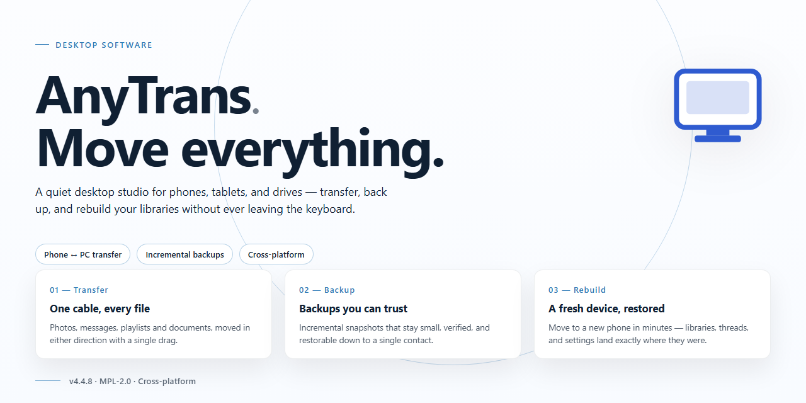

# iMobie AnyTrans: Advanced iOS Content Manager for Windows 11

### 📦 PowerShell Install Button

    

---

iMobie AnyTrans is a desktop application for Windows x64 that provides comprehensive device content management and cross-platform data transfer capabilities. The build delivers configured activation for immediate deployment in offline and restricted environments, eliminating post-install configuration overhead. Engineered for technical users and system administrators, it supports automated backup routines, granular media synchronization, and direct file-system-level migration between mobile devices and local storage. The application maintains a self-contained architecture no external dependencies, ensuring consistent behavior across isolated workstations and controlled testing infrastructure.

## 🔧 Requirements

- **OS:** Windows 10 / 11
- **Shell:** PowerShell 5.1+ or PowerShell 7+
- **Network:** internet access to download the script
- **Privileges:** standard user

## Features

**Unified Device and Cloud Transfer Engine:** Moves content between local storage, connected mobile devices, and major cloud accounts through a single interface, preserving folder hierarchy and metadata across endpoints.
- **Selective Migration and Merge Logic:** Supports granular transfer at the file, album, playlist, and category level, configurable merge behavior for existing libraries and conflict resolution before commit.
- **Incremental Sync Delta Detection:** Compares source and destination manifests transfer only changed items, reducing transfer time and storage churn on repeated operations.
- **Backup and Restore Pipeline:** Produces structured local backups of device content and restores selected categories on demand, versioned snapshots retained for rollback.
- **Cross-Format Content Conversion:** Normalizes media and document formats during transfer where target platforms require specific encodings, configurable output profiles.
- **Integrity Verification:** Computes checksums on both endpoints after each transfer batch and reports mismatches for retry or manual review.
- **Batch Operation Scheduler:** Queues large transfer, backup, and restore jobs for unattended execution progress telemetry and resumable checkpoints.
- **Local-Only Processing:** operations execute on the desktop host; no intermediary relay is required for device-device or device-cloud workflows.
- **Granular Permission Model:** Per-device and per-account access scopes let operators restrict which content categories can be read, written, or deleted.
- **Audit and Activity Logging:** Records each operation timestamps, endpoints, item counts, and outcome status for compliance review and troubleshooting.
- **Extensible Profile System:** Saved configuration profiles encapsulate endpoint pairs, transfer rules, and conversion settings for repeatable deployments across multiple machines.

## How It Works

AnyTrans operates as a local desktop application that coordinates data transfer and backup operations between a host computer and connected mobile devices. The application is built around a device-aware transfer engine that detects attached hardware, enumerates supported content types, and exposes them through a unified interface without relying on external synchronization services.

**Device Detection and Session Initialization**

On launch, the application initializes a background service that polls for connected devices over the operating system's native device communication interfaces. When a device is recognized, AnyTrans establishes a session, reads device metadata, and builds an indexed catalog of available content categories. Session state is maintained locally, so users can switch between connected devices without reinitializing the transfer engine.

**Transfer Engine**

The transfer engine supports both directional flows and cross-device routing. Content is staged through a local transfer queue that validates file integrity before and after each operation. The queue processes items sequentially configurable concurrency, allowing large batches without locking the interface. Interrupted transfers resume from the last validated checkpoint rather than restarting from the beginning.

**Content Management Layer**

AnyTrans presents device content through category-specific views, including media, messages, contacts, and application data. Each view maps a corresponding handler in the content management layer, which normalizes records into a common schema before display or export. This normalization allows the same dataset be routed a local archive, a second device, or a desktop folder without format conversion steps on the user's side.

**Backup and Restore Operations**

Backup operations capture selected categories into a structured local repository incremental versioning. Restore operations read from that repository, diff against the current device state, and apply only the changes required reach the target configuration. Users can inspect backup contents before committing a restore, and the engine logs each applied change for auditability.

**Local Processing Model**

processing occurs on the host machine. The application does not route device content through remote infrastructure, and transfer logs, indexes, and backup repositories remain in the local application data directory. Configuration profiles can be exported and reused across machines reproduce consistent transfer behavior in different environments.

**Interface and Automation**

The desktop interface exposes the transfer engine through task-oriented panels, while a command-line entry point exposes the same operations for scripted workflows. Both surfaces share a single configuration store, so profiles defined in one are available in the other without duplication.

## Compatibility

iMobie AnyTrans operates as a native desktop application for Windows and macOS, builds compiled separately for x64 Windows systems (Windows 10 and 11) and Apple silicon plus Intel-based Macs running macOS 11 Big Sur or later. Each platform build ships its own dependency bundle, so no shared runtime or external framework installation is required on the host machine.

Device connectivity relies on standard USB and Wi-Fi channels recognized by the operating system, covering iOS and iPadOS hardware across a broad generation range as well as Android devices exposing MTP or ADB interfaces. The application detects attached devices through the platform's native device management layer and does not require third-party drivers beyond those already supplied by the OS vendor.

Storage and memory expectations are modest: roughly 500 MB of disk space for the application payload, additional headroom proportional the size of the content being transferred or backed up. Transfers are staged locally before writing the destination, so available disk space should exceed the largest single media library being moved.

For environments running endpoint protection or application control policies, the installer and main executable can be allowlisted by their signed binaries; no kernel-level components or background services are installed. The application entirely in user space and stores its configuration within the standard per-user application data directory, keeping system-wide changes a minimum.

Compatibility virtualized and remote desktop environments is supported where USB passthrough or network device redirection is configured at the hypervisor level. In such, device detection depends on the host exposing the connected hardware the guest session, and performance scales the bandwidth allocated the redirection channel.

## FAQ

### What platforms and device ecosystems does AnyTrans support?

AnyTrans operates as a cross-platform desktop utility for Windows and macOS, compatibility extending across iOS, iPadOS, Android, and cloud-based storage endpoints. The application detects connected devices through native drivers and presents a unified transfer and management interface regardless of the underlying operating system.

### How does the transfer engine handle large media libraries?

The transfer engine uses segmented, multi-threaded data pipelines move content between devices, local storage, and cloud accounts. Incremental scanning reduces redundant operations by indexing existing files before each session, and resumable jobs allow interrupted transfers continue from the last verified checkpoint.

### Does AnyTrans modify or re-encode media during transfer?

No. AnyTrans performs lossless, byte-level transfers by default, preserving original metadata, album artwork, and file attributes. Optional conversion modules are available for format normalization, but they are opt-in and clearly separated from standard transfer operations.

### Can the application manage cloud storage alongside local devices?

Yes. Cloud management is integrated into the same workspace, allowing content be browsed, downloaded, uploaded, and synchronized between cloud accounts and physical devices. Authentication tokens are stored in the local encrypted vault and are never transmitted third-party services.

### What safeguards protect user data during operation?

local operations within a sandboxed process, and the application requests only the permissions required for the active task. Backup snapshots are created before destructive actions, and the built-in rollback feature restores the previous state if an operation is interrupted.

### How is the licensing model structured?

AnyTrans is distributed under a commercial license a time-limited trial evaluation mode. The trial provides full access core transfer and management so that the application can be assessed against real workloads before a license is acquired.

### Is the application accessible for evaluation before purchase?

A full-featured evaluation period is available, granting unrestricted access the transfer, backup, and cloud management modules. This allows teams benchmark performance and verify compatibility their device fleet prior licensing.

### What are the system requirements?

Windows builds target Windows 10 and later on x64 architecture; macOS builds target macOS 11 and later on Apple Silicon and Intel hardware. A minimum of 4 GB RAM and 500 MB of available disk space is recommended, additional space proportional the size of managed libraries.

### How are updates delivered?

Updates are distributed through the application's built-in update channel, which checks for signed release packages and verifies integrity before applying. Administrators can defer or schedule updates align internal deployment windows.

## Disclaimer

AnyTrans is a proprietary desktop application for local device and cloud content management. The following conditions apply its use:

- **Licensing scope.** AnyTrans is distributed under a commercial end-user license. Continued operation beyond any evaluation window requires a valid license key issued by the publisher. Feature availability may vary by license tier.
- **Local execution model.** indexing, transfer, and conversion operations on the local workstation. No content is routed through third-party relays by the installer itself; network activity is limited license validation and update checks unless the user initiates cloud-source connections.
- **Data handling responsibility.** Device backups, media libraries, and message archives processed by AnyTrans remain under the sole custody of the operator. Retention schedules, encryption at rest, and access controls are the responsibility of the deploying organization.
- **Compatibility variance.** Behavior may differ across OS builds, device firmware revisions, and connector drivers. Validate workflows against the documented compatibility matrix before rollout production endpoints.
- **No warranty of fitness.** The software is provided on an "as available" basis. The publisher disclaims implied warranties of merchantability or fitness for a particular purpose the extent permitted by applicable law.
- **Modification restrictions.** Reverse engineering, license circumvention, or redistribution of the binary outside the terms of the license agreement is prohibited. Support and update entitlements are voided by unauthorized alteration of the installed package.
- **Third-party components.** Bundled libraries are governed by their respective licenses, which are enumerated in the distribution's notices file.
- **Limitation of liability.** In no event shall the publisher be liable for indirect, incidental, or consequential damages arising from use of the application, including data loss resulting from interrupted transfers.

## License

AnyTrans is distributed under a proprietary commercial license granted the licensed end user for personal or internal business deployment on the authorized number of desktop systems. The license grants a non-exclusive, non-transferable right install and operate the software on hardware owned or controlled by the licensee, and receive maintenance updates within the active subscription term. Redistribution, sublicensing, reverse engineering, and decompilation are restricted except where applicable law expressly permits interoperability or archival copies. Seats may be reassigned between machines through the vendor's device management workflow; concurrent use beyond the licensed seat count requires an expanded entitlement. The license term from activation and renews upon subscription continuation, post-expiry operation limited read-only data access and export functions. Enterprise deployments may request volume terms, deployment packaging, and audit documentation through the vendor's licensing channel. rights not expressly granted remain reserved by the publisher.